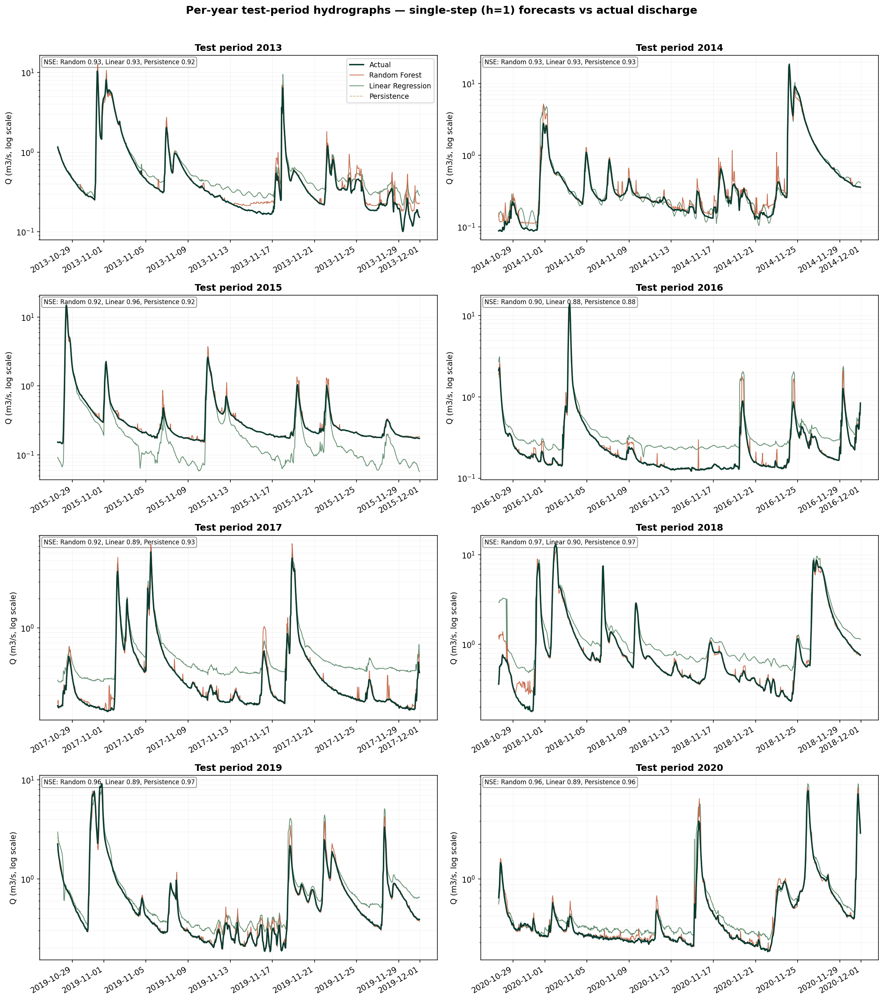

# Machine Learning for Streamflow Forecasting at Etobicoke Creek

Independent research project (ITEC 4000), York University, Summer 2026
Supervisor: Prof. Marina G. Erechtchoukova

This project forecasts hourly stream discharge at Etobicoke Creek (Toronto, gauge HY024) with three machine learning models. It then asks a methodological question: **do error-based metrics and hydrology efficiency metrics agree on which model is best?**

📄 Full write-up: [`report/ITEC4000_final_report.pdf`](report/ITEC4000_final_report.pdf)

## Data

The data is 8+ years of 15-minute discharge readings from the Toronto and Region Conservation Authority (TRCA). The raw data is not included in this repo; it is available from TRCA.

## Pipeline

1. **Preprocessing** ([`01_preprocessing.ipynb`](notebooks/01_preprocessing.ipynb))
   - Resample 15-minute readings to hourly means
   - Build a per-year hourly calendar, find gaps, and interpolate only short gaps
   - Flag outliers with physical checks and z-scores. Flood peaks are real, so they are flagged rather than dropped
   - Engineer lag and rolling features
2. **Linear regression and random forest** ([`02_linear_regression_and_random_forest.ipynb`](notebooks/02_linear_regression_and_random_forest.ipynb))
3. **LSTM** ([`03_lstm.ipynb`](notebooks/03_lstm.ipynb)): TensorFlow/Keras sequence model trained on sliding windows

Models are evaluated with **leave-one-year-out cross-validation** across eight warm seasons (2013–2020). Normalization statistics are computed per training year so test data never leaks into training. Both single-step and 24-hour autoregressive (multi-step) forecasts are produced.

Shared code (metrics, sliding windows, preprocessing helpers and paths) lives in the [`src/hydro_course`](src/hydro_course) package, so all notebooks use the same definitions.

## Metrics

| Family | Metrics | What it tells you |
|---|---|---|
| Error-based | RMAE, MAPE | Size of the forecast error |
| Efficiency | NSE, KGE | Skill compared with a mean-flow baseline |

## Results (single-step, average over 8 held-out years)

| Model | RMAE ↓ | MAPE % ↓ | NSE ↑ | KGE ↑ |
|---|---|---|---|---|
| Persistence baseline | 0.098 | 4.2 | 0.934 | 0.967 |
| Linear regression | 0.272 | 40.6 | 0.909 | 0.772 |
| Random forest | 0.110 | 7.7 | 0.936 | 0.892 |
| LSTM | 0.513 | 104.6 | 0.756 | 0.554 |

**Key findings**
- Random forest was the strongest ML model on every metric.
- One hour ahead, the simple persistence baseline ("next hour = this hour") is very hard to beat. That makes it an essential reference point.
- The metric families can disagree sharply. Linear regression scores a high NSE (0.909) while its MAPE is 40.6%. That is why reporting only NSE/KGE can overstate how accurate a model is.

Per-year results are in [`results/`](results) and plots are in [`figures/`](figures).



## Tech stack

Python, pandas, NumPy, scikit-learn, TensorFlow/Keras, Matplotlib, Jupyter / Google Colab

## Running the notebooks

The notebooks were run in Google Colab. Install the dependencies, add `src/` to your Python path, put the TRCA data where `src/hydro_course/paths.py` expects it, then run the notebooks in order:

```bash
pip install pandas numpy scikit-learn tensorflow matplotlib joblib
```
